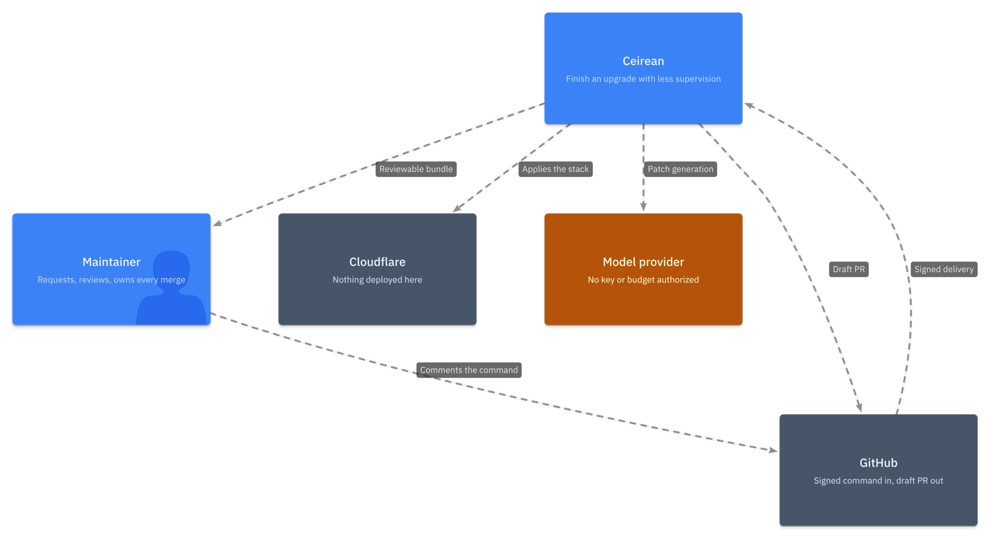
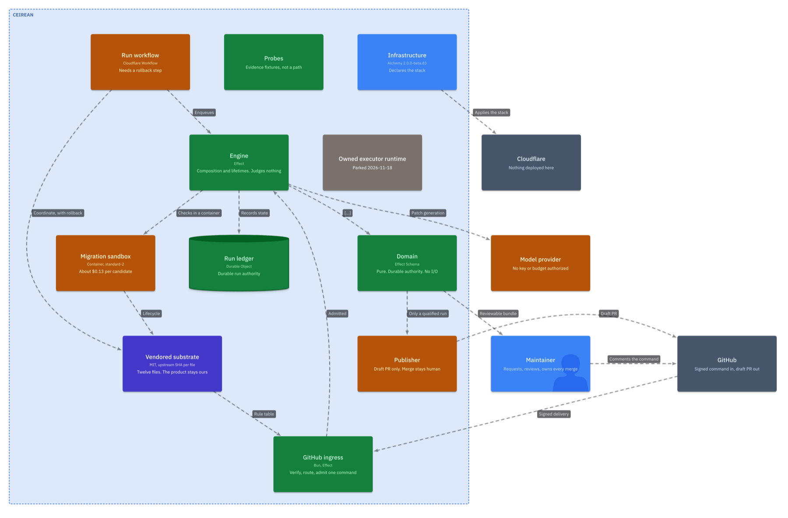

# Ceirean


Guardian of the deep. Autonomous repository repair and pull requests.

Ceirean helps a maintainer finish a dependency or source-API upgrade with less
supervision. It takes a requested migration, reproduces the target repository at
an immutable revision, applies the change in isolation, verifies the result
independently of the agent that produced it, and returns a reviewable patch bound
to evidence. Producing more version-bump pull requests is not the measure.

It is an internal service, built to dogfood across Opsydyn repositories before
any broader product is considered. The local checkout may still be named
`Leviathan`; directory names are not product identity.

**Nothing here runs unsupervised.** Every step that reaches outside this
repository — running a container, calling Cloudflare, installing a GitHub App,
using a credential, opening a pull request — is a separate approval gate, and
none of them is open. The [architecture model](docs/architecture/README.md) marks
each one by colour.

## What it does

```text
Approved request -> pinned repository -> isolated baseline + browser evidence
  -> Flue migration patch -> independent verification -> maintainer review
  -> separately authorized draft PR
```

Each arrow is a refusal point rather than a handoff. An unchanged baseline must
pass before a migration is attempted, so pre-existing failures block
qualification instead of being absorbed into it. Verification runs the
maintainer's own acceptance checks against a frozen candidate, and a receipt
binds the result to the exact source, patch and toolchain. Agent completion is
not proof of qualification.

## Repository layout

```text
.
├── .github/
│   ├── actions/setup/         Composite toolchain step: Bun, Moon, frozen install
│   └── workflows/check.yml    The gate: lint, 14 typechecks, 13 test targets
├── .moon/                     Project graph, toolchains and task definitions
├── apps/
│   ├── github-ingress/        Signed GitHub admission, verification, operator CLI
│   └── replay/                Replay of a frozen profile against recorded evidence
├── packages/
│   ├── domain/                Pure qualification evidence and run decisions
│   ├── engine/                Qualification coordinator, verification plan, ports
│   ├── github-adapter/        GitHub transport behind the engine's ports
│   ├── infrastructure/        Gated Alchemy stack declaration; never deployed
│   └── migration-storage/     Run and migration persistence contracts
├── probes/                    Evidence fixtures, one per question asked
│   ├── bun-effect-flue/       Bun, Effect and Flue compatibility
│   ├── cloudflare-executor/   Offline payload preparation for a sandbox
│   ├── cloudflare-ledger/     Durable-object ledger semantics
│   ├── colima-readiness/      Local container host readiness
│   ├── factory-binding/       Astro Factory substrate binding
│   └── github-admission/      Offline `/ceirean assess` command admission
├── vendor/factory/            Vendored Astro Factory substrate; MIT, provenance per file
├── patches/                   Version-scoped, declaration-only dependency repairs
├── profiles/                  Frozen replay profiles
├── qualification/             Inactive CI workflows and run worksheets
├── docs/                      Documentation; see the index below
├── .prototools                Exact Moon, Bun and Node pins
├── moon.yml                   Root project: lint, format and check tasks
├── package.json               Private Bun workspace root
└── bun.lock                   One root lockfile
```

Moon owns the project graph and tasks; Bun owns workspace dependencies, the
lockfile and execution. Domain, engine and the probes are private workspaces. Do
not scaffold empty production packages. Evidence tasks run uncached with no
automatic retries, and Moon is neither Ceirean's durable run coordinator nor its
container security boundary.

## Architecture

[`docs/architecture/ceirean.c4`](docs/architecture/ceirean.c4) is the current
architecture, written in LikeC4. Every element carries its real status as a tag
and the tag sets its colour, because what this project most needs to communicate
is not the shape of the pipeline but where the approval gates fall across it:
green is built and evidenced, indigo is vendored upstream source, orange needs an
explicit separate approval, red is a known missing check, stone is deliberately
parked, slate is not ours.

<picture>
  <source media="(prefers-color-scheme: dark)" srcset="docs/architecture/views/index-dark.png">
  
</picture>

One level down, the amber blocks are the whole of what remains ungated — a
sandbox, a workflow and a publisher — and the one red block is the missing
required-secret preflight.

<picture>
  <source media="(prefers-color-scheme: dark)" srcset="docs/architecture/views/containers-dark.png">
  
</picture>

[All six views](docs/architecture/README.md), including the admission path, the
verdict chain, and one showing only what sits behind a gate. The images are
derived: when they and the model disagree, the model is right.

## Checks

Every pull request runs [the gate](.github/workflows/check.yml) — lint and
format, 14 typecheck targets, and 13 test targets as one job each so a single run
reports every failure. `main` requires its aggregate `Gate` check and refuses
direct pushes. The gate can also be run on demand:

```sh
gh workflow run check.yml --ref main
```

Locally, install the pinned tools with `moon setup`, then dependencies with
`bun install --frozen-lockfile --ignore-scripts`:

```sh
bun run check                 # Oxlint, then oxfmt --check
bun run lint:fix              # Apply available fixes, then review them
bun run format                # Format owned source, config and docs
moon run :typecheck           # Every typecheck target
moon run :test                # Every test target
moon run engine:test          # One project
```

Bun 1.4.2 runs applications and tests. Node 24.15.0 is developer tooling only —
standalone Oxlint needs it for its JavaScript plugin and TypeScript config — and
is not a runtime fallback. Moon does not install workspace dependencies for you.

`oxlint.config.ts` enables every Effect 4-applicable rule from
`@opsydyn/oxlint-effect@2.0.1`: 141 rules, all errors, including the 20 beyond
`recommendedRules`. There are no blanket source or test exclusions and no rule
disables; native adapter and test boundaries are explicit paths, and warnings
fail the gate. `oxfmt@0.73.0` owns formatting and `oxlint@1.88.0` owns linting.

## Documentation

| Where                                                | What it holds                                   | Add to it when                                  |
| ---------------------------------------------------- | ----------------------------------------------- | ----------------------------------------------- |
| [`docs/architecture/`](docs/architecture/README.md)  | The LikeC4 model and its six rendered views     | The shape of the system changes                 |
| [`docs/decisions/`](docs/decisions/)                 | Numbered ADRs                                   | A consequential, hard-to-reverse choice is made |
| [`docs/roadmap.md`](docs/roadmap.md)                 | The active delivery map                         | A slice is planned, delivered or parked         |
| [`docs/superpowers/specs/`](docs/superpowers/specs/) | Approved designs, dated                         | A slice is designed before it is built          |
| [`docs/superpowers/plans/`](docs/superpowers/plans/) | Approved implementation plans, dated            | A design becomes an ordered task list           |
| [`docs/assessments/`](docs/assessments/)             | What was measured, and what it does not qualify | Work finishes and its limits need recording     |
| [`docs/evidence/`](docs/evidence/)                   | Source-bound run records and receipts           | A run produces evidence worth citing            |
| [`docs/runbooks/`](docs/runbooks/)                   | Operator procedures and approval worksheets     | A person has a sequence to follow               |

The [documentation index](docs/README.md) describes each of these in full,
including which are historical and must not be edited in place.

## Status

[The roadmap](docs/roadmap.md) is the active map; its checkboxes record evidence,
not permission to execute. Slices 1 to 4 are delivered and local. Everything that
runs a container, touches Cloudflare, installs a GitHub App or uses a credential
is slice 5, and each of those is its own approval gate. The owned executor
runtime is parked as of 2026-11-18; see the roadmap's parking record before
planning another runtime slice.

There is no deployed application and no scheduled job. Live controls are off, and
the [rehearsal approval worksheet](docs/runbooks/ceirean-rehearsal-approval.md)
governs resuming ingress or selecting any real target. Historical status prose,
including what each completed slice did and did not qualify, is kept verbatim in
the [README history](docs/readme-history-20261123.md).
