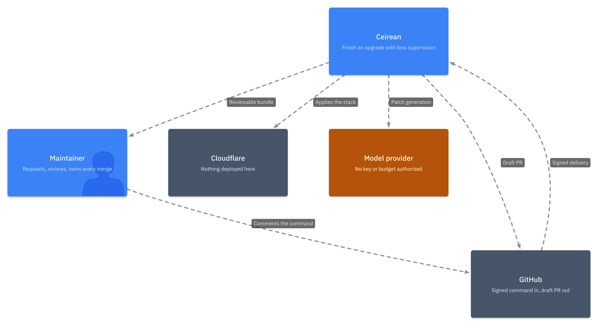
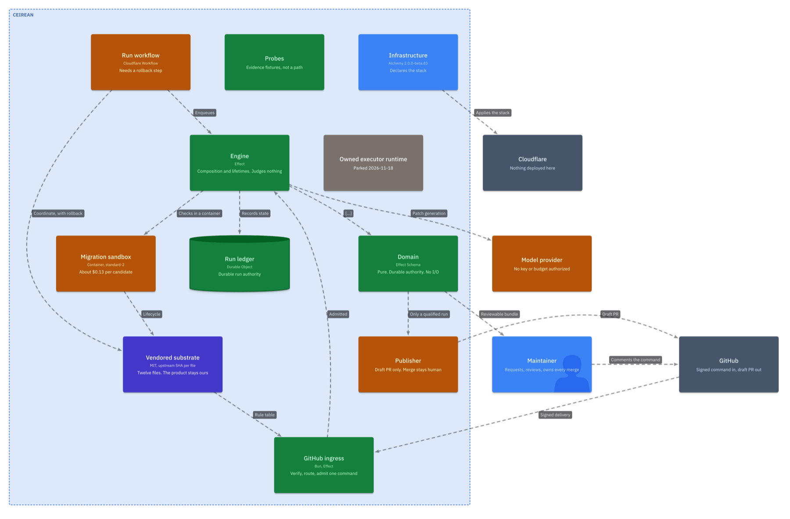
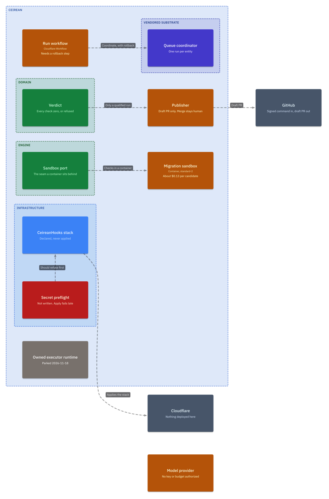
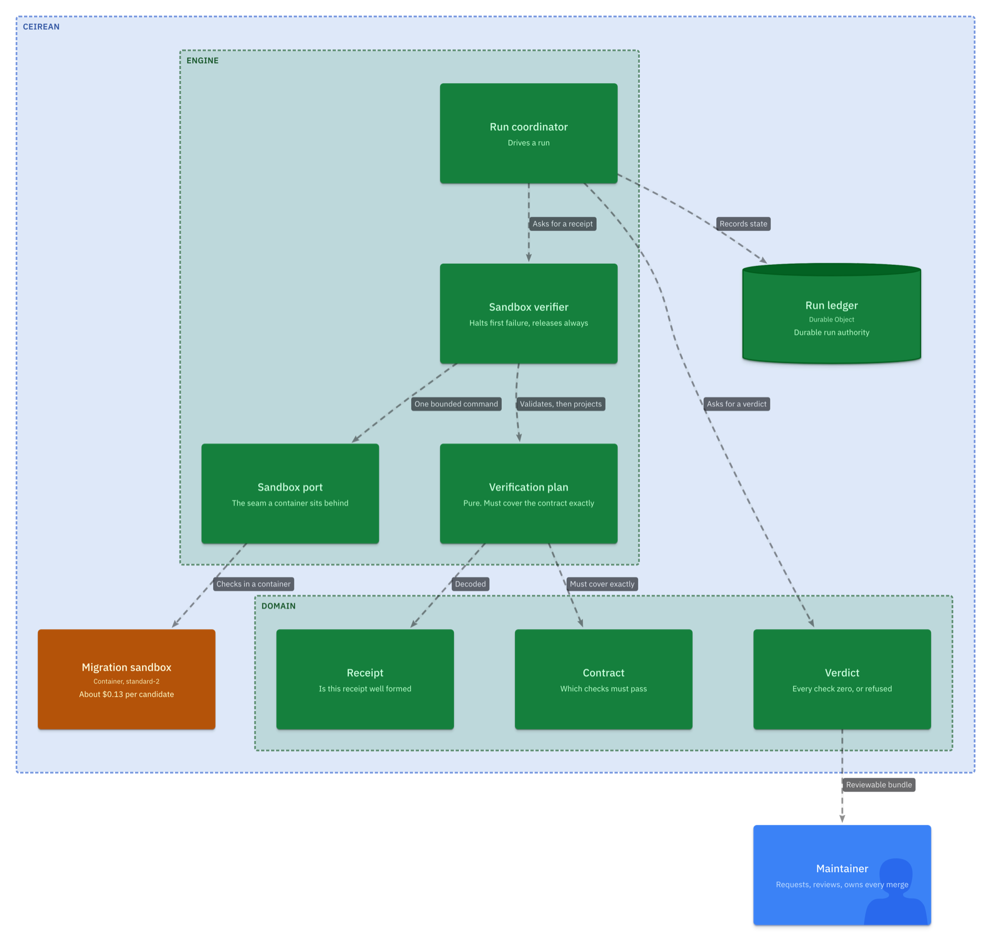
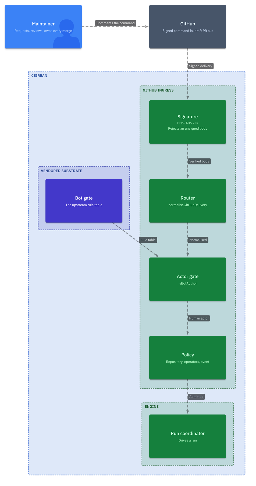
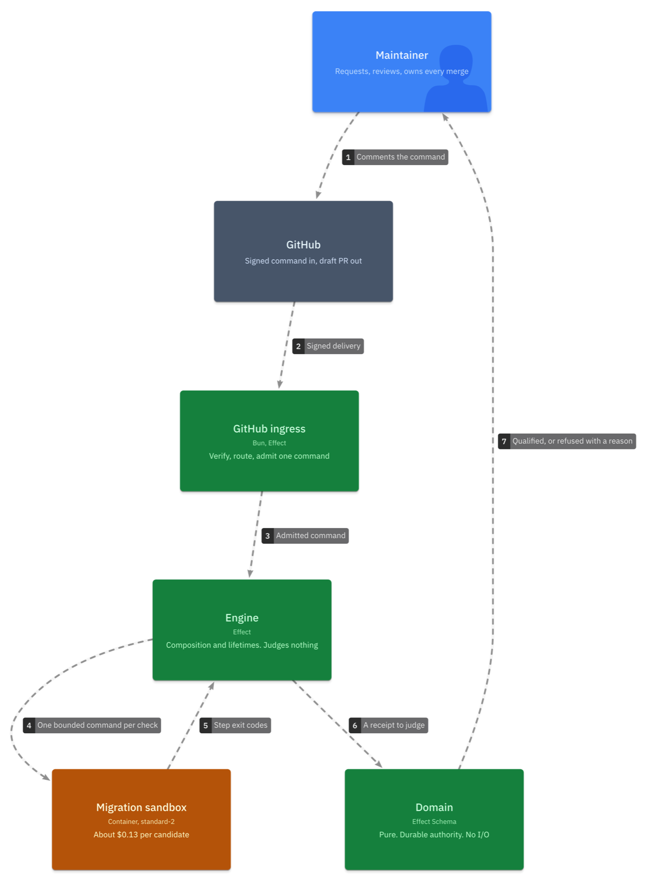

# Architecture

[`ceirean.c4`](ceirean.c4) is the source. These images are exported from it and
are therefore derived: when the two disagree, the model is right. Node text is
deliberately terse so a view reads at a glance — the reasoning is in the prose
under each image, not inside the boxes.

Every element carries its real status as a tag, and the tag sets its colour, so
a view answers "what is actually built?" without a key:

| Tag         | Colour | Meaning                                                      |
| ----------- | ------ | ------------------------------------------------------------ |
| `#proven`   | green  | Built, tested and evidenced in `docs/evidence`               |
| `#vendored` | indigo | Upstream Astro Factory source, MIT, provenance per file      |
| `#gated`    | orange | Designed, not built; needs an explicit separate approval     |
| `#gap`      | red    | A known missing check, named in evidence and not yet written |
| `#parked`   | stone  | Deliberately stopped; see the roadmap's parking record       |
| `#external` | slate  | Not ours                                                     |
| no tag      | blue   | Outside that axis: a person, or a declaration never applied  |

Nothing in a `#gated` element has been deployed. The one Cloudflare Worker that
ever existed was torn down to an expired, routeless state on 2026-10-30 and
verified private.

## Ceirean in context

Who asks, what it talks to, and what it is for.

<picture>
  <source media="(prefers-color-scheme: dark)" srcset="views/index-dark.png">
  
</picture>

## Inside Ceirean

One level down. The amber blocks are the whole of what remains ungated: a
sandbox, a workflow and a publisher.

<picture>
  <source media="(prefers-color-scheme: dark)" srcset="views/containers-dark.png">
  
</picture>

## Behind an approval gate

The gated material, plus the proven elements it would attach to, so the view
shows the seam rather than an island: the sandbox port, the qualification
decision and the vendored queue coordinator are green here because they are
built and waiting. Read it as the distance between what is proven and what the
product outcome requires.

<picture>
  <source media="(prefers-color-scheme: dark)" srcset="views/gates-dark.png">
  
</picture>

## The verdict chain

Why the acceptance contract is not redundant: the sandbox produces evidence and
the domain judges it, and the two never meet. `projectReceipt` refuses results it
cannot account for rather than deciding what happened to them, and
`decideQualification` accepts only when every planned check completed with a zero
exit.

<picture>
  <source media="(prefers-color-scheme: dark)" srcset="views/verdict-dark.png">
  
</picture>

## Admission

The path a signed command actually takes. The actor gate is there because a
classic bot on a plain user account, which GitHub reports as `User`, previously
reached admission by posting the command.

<picture>
  <source media="(prefers-color-scheme: dark)" srcset="views/admission-dark.png">
  
</picture>

## One assessment, in order

The same request as a sequence rather than a structure.

<picture>
  <source media="(prefers-color-scheme: dark)" srcset="views/assessment-dark.png">
  
</picture>

## Regenerating

The model validates and lays out under LikeC4 1.61.0. This repository does not
depend on LikeC4, and acquiring it is a separate gate; the exports above were
produced with an installation that already existed elsewhere on the machine.

```sh
likec4 validate docs/architecture
likec4 start docs/architecture                       # browse all six views
likec4 export png docs/architecture -o out --flat --light
likec4 export png docs/architecture -o out --flat --dark
```

Then cap each image at 1800px on the long edge and flatten it. LikeC4 exports a
**transparent** canvas, which makes a diagram's contrast depend on whatever page
it lands on, so [`flatten-png.py`](flatten-png.py) composites each one onto an
explicit background — white for the light set, `#0d1117` for the dark — and drops
the alpha channel. That is also why the twelve images take 2.7 MB rather than
3.7 MB.

```sh
sips -Z 1800 out/index.png --out views/index-light.png
python3 docs/architecture/flatten-png.py views/index-light.png ffffff
python3 docs/architecture/flatten-png.py views/index-dark.png 0d1117
```

The script is stdlib-only and the single piece of Python here; it exists because
neither ImageMagick nor Pillow is available on this machine and the alternative
was an undocumented manual step.

Do not run `likec4 export markdown` in this folder: it writes its own `README.md`
and would overwrite this one.
